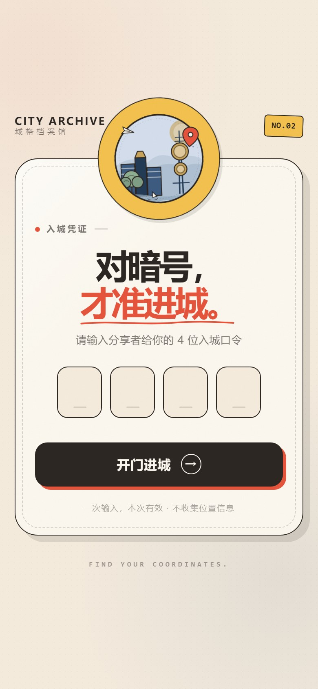
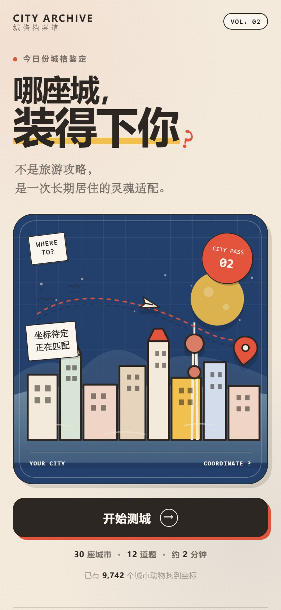
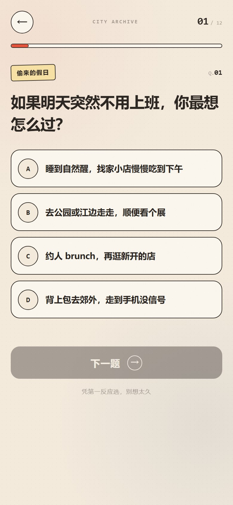
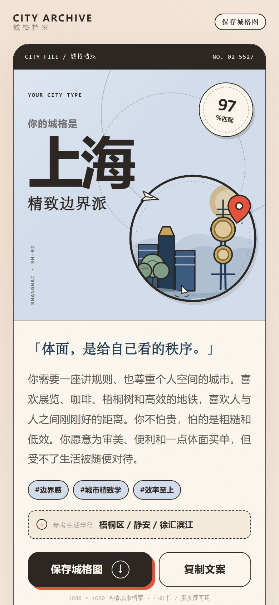
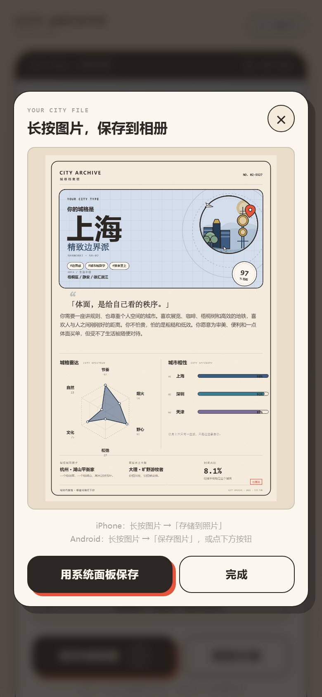

# 城格档案馆 · 哪座城装得下你

一个手机优先、纯静态、零依赖的居住城市测试。12 道关于生活节奏、烟火气、野心和自然感的题，测出真正适合你长期居住的城市；结果自动生成 **1080 × 1620 高清长图**，手机可保存到相册。

这是「测试合集」里的第二个测试，和猫格档案馆共用一套档案视觉语言，但主题、题目、插画和结果全部重新设计。

| 入城口令 | 封面 | 答题 |
| --- | --- | --- |
|  |  |  |

| 城格结果 | 保存海报 |
| --- | --- |
|  |  |

[查看完整结果长图](preview/result-full.jpg) · [查看 1080 × 1620 海报原图](preview/poster.jpg)

---

## 现在能做什么

- **入城口令**：4 位口令，当前是 `1290`；在当前标签页内有效，刷新不用重复输入。封面不展示口令。
- **12 道题**：日常场景式单选，可返回修改，支持键盘 `1`~`4` 和 `Enter`。
- **30 座城**：成都、重庆、长沙、昆明、贵阳、上海、深圳、天津、北京、武汉、合肥、沈阳、大理、桂林、拉萨、广州、泉州、南昌、福州、杭州、南京、苏州、厦门、青岛、珠海、三亚、西安、洛阳、兰州、哈尔滨。
  - 覆盖直辖市、省会和苏州、青岛、深圳、厦门、大理、泉州、洛阳、桂林、三亚、珠海等非省会城市，不是只按行政级别挑选。
- **六维城格雷达**：节奏、烟火、野心、松弛、文化、自然。
- **结果档案**：匹配度、城格雷达、城市相性、日常需求、周末充电、城市天赋与盲点、宜居说明书、城市关系、参考生活半径。
- **保存到相册**：生成 1080 × 1620 PNG。
  - 支持系统分享的浏览器点「用系统面板保存」，在系统面板里选「存储图像 / 保存图片」。
  - 不支持时下载图片；iOS / 微信内改为提示长按保存。
  - 弹层里的海报始终可以长按保存，微信里同样可用。
- **一键复制文案**：带城市、匹配度、标签和当前网址。
- **零外部依赖**：没有 CDN、没有字体请求、没有统计脚本。
- **纯静态**：无构建步骤，GitHub Pages / Cloudflare Pages 均可。

> 口令是前端校验，只能挡住随手打开的人，**不是真正的访问控制**。源码里能直接看到口令。

---

## 本地预览

在仓库根目录：

```bash
python -m http.server 8080
```

打开：

```text
http://localhost:8080/city-archive/
```

口令：`1290`。

也可以单独进入 `city-archive/` 目录启动服务器。

---

## 目录

```text
city-archive/
├── index.html          # 口令 / 封面 / 答题 / 结果 / 海报弹层
├── style.css           # 城市档案视觉与响应式
├── data.js             # ★ 口令、30 座城文案、12 道题、8 个母题
├── scoring.js          # 六维归一化、母题匹配、具体城市落点
├── art.js              # 30 座城市插画（8 个专属 + 场景/地标组合）
├── app.js              # 交互、雷达图、Canvas 海报、保存 / 分享 / 复制
├── preview/            # 展示图
├── tools/simulate.cjs  # 随机答题分布测试（开发用，可不上传）
├── _headers            # Cloudflare Pages 响应头
├── robots.txt
└── .nojekyll
```

---

## 怎么改

### 改口令

打开 `data.js` 顶部：

```js
const DATA = {
  passcode: '1290',
  // ...
};
```

改成你想要的 4 位数字，并保持输入框 `maxlength="4"` 一致。

### 改城市 / 题目

都在 `data.js`：

| 想改什么 | 改哪里 |
| --- | --- |
| 六维名称 | `DIMENSIONS` 的 `name` / `low` / `high` |
| 城市名、标题、文案 | `TYPES[].name` / `.title` / `.desc` / `.quote` / `.tags` |
| 城市配色 | `TYPES[].color` / `.soft` / `.deep` / `.accent` / `.water` |
| 城市画像 | `TYPES[].profile`，六个维度各 0~100 |
| 城市所属母题 | `GROUP_OF`；母题画像在 `GROUPS` |
| 参考生活半径 | `TYPES[].area` |
| 日常 / 充电 / 盲点 | `TYPES[].daily` / `.recharge` / `.blind` |
| 最佳搭子 / 水土不服 | `TYPES[].best` / `.bestWhy` / `.clash` / `.clashWhy` |
| 同类占比 | `TYPES[].rarity` |
| 题目 | `QUESTIONS[].q` / `.options[].text` |
| 选项加分 | `QUESTIONS[].options[].scores`，六维 0~3 分 |
| 选项偏向的母题 | `QUESTIONS[].options[].types`，值为 8 个母题 id |

改完题目后跑一次分布测试：

```bash
node tools/simulate.cjs
```

### 换插画 / 配色

- 8 座主力城市有专属插画，分支在 `chengdu()` / `shanghai()` 等函数里。
- 其余城市用 `scene` + `landmark` 组合：场景在 `GENERIC_SCENES`，地标在 `LANDMARKS`。
- 新增城市时在 `TYPES` 里填 `scene` 和 `landmark` 即可；没有填则自动落到 `metro` 场景。
- 封面天际线在 `art.js` 的 `heroCitySvg()`。
- 页面主配色在 `style.css` 顶部的 `:root`。
- 海报排版在 `app.js` 的 `buildPoster()`，尺寸 1080 × 1620。

---

## 部署到「测试合集」

这个测试位于主仓库的 `city-archive/` 子目录，根目录的 `index.html` 是合集入口。

### Cloudflare Pages

- 连接仓库
- Production branch：`main`
- Framework preset：`None`
- Build command：留空
- Build output directory：`/`

根入口会列出猫格和城格两个测试。Cloudflare 每次推送 `main` 会自动重新部署。

### GitHub Pages

仓库 Settings → Pages → `main` / `/(root)`。根目录的 `.nojekyll` 会让静态文件按原样发布。

---

## 保存图片的实际情况

不同浏览器对「网页直接写入相册」的支持不同，所以做了三层兜底：

1. **系统分享**：支持文件分享的浏览器，点按钮打开系统面板，选「存储图像 / 保存图片」。
2. **下载**：不支持系统分享时下载 PNG。
3. **长按**：弹层里始终显示完整海报，iPhone 长按选「存储到照片」，Android / 微信长按选「保存图片」。

海报是 1080 × 1620 PNG，文字和雷达图都由 Canvas 现场绘制，不依赖 html2canvas。

---

## 说明

- 题目、城市文案、插画和海报设计均为本项目单独创作，没有使用第三方测试题库或外部素材。
- 城市文案是生活方式向的「城格」描述，不是对真实城市的全面评价，也不构成搬迁建议。
- 页面不收集位置信息，不调用地图接口。
